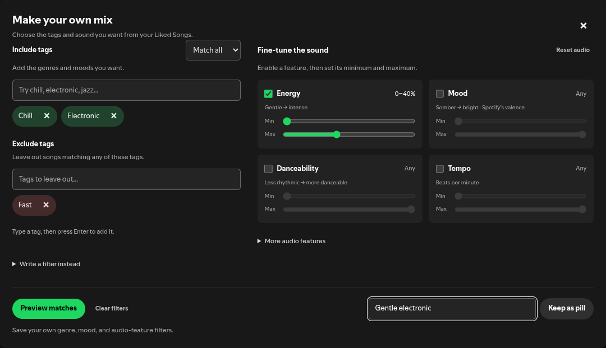

# Spicetify Rice

Malte's Spicetify extensions and customizations. Each extension lives under
`extensions/`; the root `manifest.json` lists the extensions discoverable by
Spicetify Marketplace. More modifications can be added without creating a
separate repository for each one.

## Liked Song Filters

[Liked Song Filters](extensions/liked-song-filters/README.md) adds **Add Tag**
beside Download in Liked Songs. Combine included/excluded genres and moods with
audio-feature sliders, preview matching songs, and save reusable filter pills.
Saved pills and drafts persist across Spotify restarts.



This version previews matches in its own panel (complete count, first 20 songs);
it does not replace Spotify's native tracklist. It relies on private Spotify
APIs, whose availability can change.

Find **Liked Song Filters** in Spicetify Marketplace's Extensions tab once the
repository has been indexed. For manual installation, download
[`liked-song-filters.js`](https://raw.githubusercontent.com/goopii/spicetify-rice/main/extensions/liked-song-filters/dist/liked-song-filters.js)
into your Spicetify `Extensions` directory, then run:

```sh
spicetify config extensions liked-song-filters.js
spicetify apply
```

Restart Spotify and open Liked Songs. Enable one installation of the extension
at a time; use either the manual copy or Marketplace's copy.

## Development

```sh
npm run build
npm test
```

No dependency installation is needed. Commit the generated bundles with source
changes so Marketplace can install them directly. See
[PUBLISHING.md](PUBLISHING.md) for discovery and updates.

Licensed under [MIT](LICENSE).
